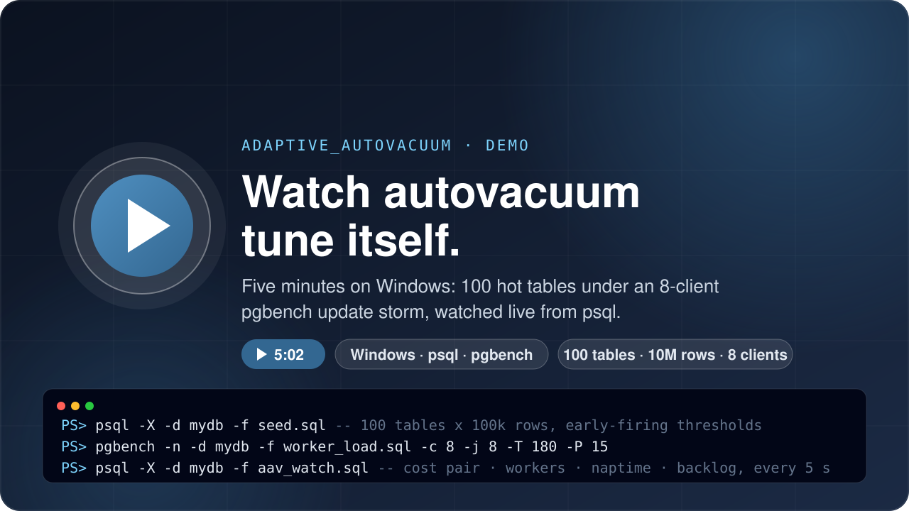

# 🎬 adaptive_autovacuum demo kit

Everything used in the five-minute demo recording: the video itself (MP4, plus the GIF that plays inline in the main README), the seed and load scripts, the psql dashboard shown on screen and a reset script for replaying it.

<p align="center">
  <a href="AAV_DEMO_20261017.mp4" title="Watch the demo (MP4, 5 min)">
    
  </a>
</p>

**▶️ [Watch the demo](AAV_DEMO_20261017.mp4)** · 5 min · recorded on Windows · [back to the main README](../README.md)

## 📁 What is in the folder

| File | Purpose |
|---|---|
| `AAV_DEMO_20261017.mp4` | The recording (5 min, 1280 × 680). GitHub plays it in the browser when you open the file. |
| `AAV_DEMO_20261017.gif` | The same recording at one frame per second (960 px wide, 128 colours, about 8 MB), embedded in the [main README](../README.md#-see-it-in-action) because GitHub cannot play a repository MP4 inline. Regenerate it with the ffmpeg command at the end of this page. |
| `demo-poster.svg` | Cover card for this page. |
| `install.ps1` | The Windows one-line installer used in the recording (release 1.3.1), kept here so the kit is self-contained. The current copy is always on the [Releases](https://github.com/secp256k1-sha256/adaptive_autovacuum/releases/latest) page. |
| `seed.sql` | Creates `worker_test_1` … `worker_test_100` with 100,000 rows each and sets `autovacuum_vacuum_threshold = 1000`, `autovacuum_vacuum_scale_factor = 0` on every table so vacuum work starts within seconds of load. Demo settings, not production advice. |
| `worker_load.sql` | pgbench script: each transaction updates one random row in one random table out of the 100. |
| `aav_watch.sql` | The on-screen dashboard. It hops to the control database and prints the live autovacuum settings and running workers, then the controller's last ten global recommendations: cost pair, workers, naptime, dead tuples, overdue relations, backlog trend and vacuum read / write MB/s. |
| `reset_history.sql` | Wipes the controller's learned state and history so a replay starts like a fresh install. Run it in the control database with the controller disabled. |

## 🚀 Run it yourself

You need PostgreSQL 17 or 18 with `psql` and `pgbench` on the path, superuser access, a scratch database and the extension installed ([Quick install](../README.md#-quick-install)). Install with `-NoEnable` / `--no-enable`, or set `adaptive_autovacuum.enabled = off`, so you can watch stock autovacuum struggle first and switch the controller on mid-load, as in the recording.

**1. Seed the scratch database** (10 million rows; allow a few minutes):

```powershell
createdb mydb
psql -X -d mydb -f .\seed.sql
```

**2. Window A: the dashboard.** Refresh every five seconds; `Ctrl+C` stops the loop.

```powershell
while ($true) { Clear-Host; psql -X -d mydb -f .\aav_watch.sql; Start-Sleep -Seconds 5 }
```

On Linux: `watch -n 5 psql -X -d mydb -f aav_watch.sql`.

**3. Window B: switch the controller on and start the storm.**

```powershell
psql -X -c "ALTER SYSTEM SET adaptive_autovacuum.enabled = on"
psql -X -c "SELECT pg_reload_conf()"
pgbench -n -d mydb -f .\worker_load.sql -c 8 -j 8 -T 180 -P 15
```

**4. What to watch** in Window A as the three minutes run:

| Column | What it tells you |
|---|---|
| `av_running` / `max_workers` | Whether the autovacuum pool is saturated. |
| `cost_pair` | `cost_limit / cost_delay_ms` the controller recommends; `held` means no change from the previous check. |
| `workers`, `naptime` | Recommended pool size and launcher interval. On PostgreSQL 18 worker increases are applied live. |
| `dead_tuples`, `overdue`, `trend` | Maintenance debt, tables past their trigger and whether the backlog is growing or draining. |
| `read_mbps`, `write_mbps` | What the autovacuum workers are actually moving. |

Every change is also recorded with its previous value in `adaptive_autovacuum.global_apply_queue`, and `adaptive_autovacuum.decisions` explains the reasoning.

**5. Replay or clean up.**

```sql
-- in the control database (postgres by default)
UPDATE adaptive_autovacuum.policy SET enabled = false;
\i reset_history.sql
-- put back any autovacuum settings the controller changed; the queue lists the previous values
SELECT guc_name, old_value, desired_value, status FROM adaptive_autovacuum.global_apply_queue ORDER BY id DESC;
```

```powershell
dropdb mydb
```

## 🎞️ Regenerating the GIF

The README animation is the full MP4 at one frame per second, with the top 44 px (the remote-desktop toolbar) cropped off, scaled to 960 px and quantised to 128 colours without dithering so the terminal text stays sharp:

```bash
ffmpeg -i AAV_DEMO_20261017.mp4 \
  -filter_complex "[0:v]crop=1280:636:0:44,fps=1,scale=960:-1:flags=lanczos,split[a][b];[a]palettegen=max_colors=128:stats_mode=diff[p];[b][p]paletteuse=dither=none:diff_mode=rectangle" \
  AAV_DEMO_20261017.gif
```
